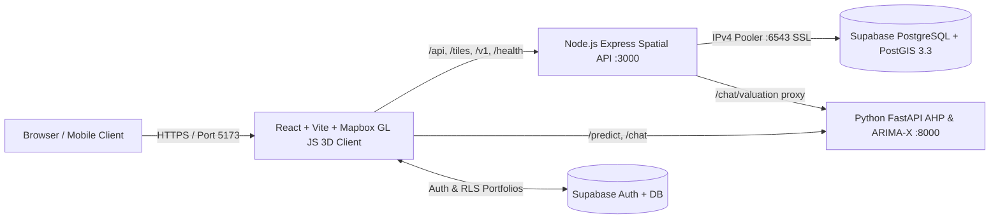

# GeoValue 2.0 — Indian PropTech Risk Intelligence & 150-Factor GIS Valuation Platform


**GeoValue 2.0** is an enterprise-grade Indian real estate intelligence, **Saaty AHP multi-criteria land valuation**, and **ARIMA-X 10-year forecasting** platform built for **Pan-Delhi NCR** (**Noida Sector 128, New Delhi, Gurugram, Ghaziabad, and Faridabad**).

Zero USD assumptions—every financial ledger, registry comparable, interactive forecast chart, AI copilot insight, and printable 4-page Senior GIS dossier operates natively in **Indian Rupees (`₹`)**, **Indian numbering (`₹/Gaj`, `₹ Lakhs`, `₹ Crores`)**, and **Sq. Yards (`Gaj`) / Sq. Meters**.

---

## System Architecture

### Logical Data Flow



### Deployment & Proxy Topology

```text
+-----------------------------------------------------------------------------+
|  Remote Demo / Browser (http://localhost:5173 or Public Tunnel HTTPS URL)   |
+--------------------------------------+--------------------------------------+
                                       |  Single-Origin Relative Paths
                                       v
+-----------------------------------------------------------------------------+
|  Vite Dev Server / Vercel SPA  (react-client/  —  Port 5173, host: true)    |
|  - Obsidian 3D Mapbox GL JS Canvas, Risk Choropleth, 5 NCR Overlays         |
|  - 4-Page 150-Factor Printable A4 Senior GIS Dossier & Recharts UI          |
+---------------------+------------------------------------+------------------+
                      | /api, /tiles, /v1, /health         | /predict, /chat
                      v                                    v
+-----------------------------------+    +------------------------------------+
|  Node.js Spatial API (Port 3000)  |    |  Python FastAPI Engine (Port 8000) |
|  - Express + Hardened pg.Pool     |--->|  - 6x6 Saaty AHP Matrix (CR<0.10)  |
|  - MVT Vector Tiles (204 fallback)|    |  - statsmodels ARIMA-X 3Y/5Y/10Y   |
|  - Pan-NCR BBox Parcel Synthesis  |    |  - GroupKFold RF + XGBoost Model   |
|  - 5 NCR GeoJSON Spatial Overlays |    |  - Parcel-Aware AI Chat Engine     |
+-----------------+-----------------+    +------------------------------------+
                  |  SSL over IPv4 Transaction Pooler (:6543)
                  v
+-----------------------------------+
|  Supabase PostgreSQL + PostGIS    |
|  - municipal_parcels (GiST index) |
|  - saved_portfolios (Row Security)|
+-----------------------------------+
```

---

## Core Engineering Capabilities

1. **Scientific Saaty AHP Valuation Engine (`CR = 0.0131 < 0.10`)**
   - Evaluates parcels via a mathematically verified **6×6 Pairwise Comparison Matrix** ($\lambda_{\max} = 6.0813$, **Consistency Ratio `CR = 0.0131 < 0.10`**) across:
     1. Recent Comparable Registry Rate
     2. Metro / RRTS & Expressway Proximity
     3. Upcoming Govt Policy & Master Plan Catalysts
     4. Flood, Soil & Environmental Hazard Safety
     5. Social Infrastructure (Hospitals, Malls & Schools)
     6. Crime Rate & Neighborhood Safety Index
   - Outputs explainable `±₹/Gaj` adjustment ledgers, **Circle-to-Market spread (%)**, total plot valuation in **₹ Lakhs / ₹ Crores**, and spatial ML ensemble support (`python-risk-service/app/ml_pipeline.py` with spatially blocked `GroupKFold`, RandomForest + XGBoost).

2. **5 Toggleable Delhi-NCR Spatial Overlays (`/api/layers/ncr-overlays`)**
   - `metro_rrts`: Namo Bharat RRTS & DMRC/NMRC stations & transit alignments
   - `roads_expressways`: Yamuna Expressway, Noida–Greater Noida Expressway, Dwarka Expressway & arterials
   - `social_infra`: Major hospitals, malls, universities & tech hubs
   - `flood_hazard`: Yamuna / Hindon floodplain buffer zones
   - `crime_safety`: Police corridors & municipal safety index zones

3. **Recent Comparable Registry Engine & Policy Catalysts**
   - Surfaces **5 verified sub-registrar registry comparables** calibrated in **`₹/Gaj`** alongside active **Delhi-NCR Policy & Master Plan catalysts** (Noida International Airport / Jewar corridor, RRTS nodes, Master Plan 2041 FAR/TOD uplifts).

4. **ARIMA-X 3Y / 5Y / 10Y Price Trajectory Forecasting (`statsmodels`)**
   - Generates multi-horizon land appreciation forecasts across **Baseline**, **Infrastructure-Accelerated**, and **Adverse-Risk** scenarios displayed interactively in Recharts (`₹/Gaj`).

5. **4-Page 150-Factor (`F-001`–`F-150`) Senior GIS Due-Diligence PDF Report**
   - Instant printable A4 dossier (`GISReportModal`) featuring **5 Trust Seals**, executive valuation summary, Saaty AHP weightage table, 5 comparable registry deeds, full **150 spatial/legal/environmental factors across 10 domains**, and 10-year ARIMA-X tables formatted with `@media print`.

---

## Repository Layout

```text
GeoValue-2.0/
├── react-client/               # Vite + React + Mapbox GL JS 3D client (port 5173 + reverse proxy)
│   ├── .env.example            # Frontend env template (Mapbox token, optional remote API & Supabase URLs)
│   ├── vercel.json             # 1-click Vercel SPA hosting config
│   └── vite.config.js          # Single-URL proxy (/api, /tiles, /v1, /health, /predict, /chat)
├── node-api/                   # Node.js Express + PostGIS spatial API (port 3000)
│   ├── .env.example            # Node env template (PORT, Supabase Pooler DATABASE_URL, RISK_SERVICE_URL)
│   └── src/index.js            # Hardened pg.Pool, MVT tiles, pan-NCR bbox parcels, 5 NCR overlays
├── python-risk-service/        # FastAPI ML, Saaty AHP & ARIMA-X service (port 8000)
│   ├── .env.example            # Python service env template
│   └── app/                    # main.py, forecasting.py, ml_pipeline.py
├── database/                   # PostGIS & Supabase SQL migrations
│   ├── 01_municipal_parcels.sql
│   └── 02_saved_portfolios.sql
├── render.yaml                 # Render Blueprint for node-api + python-risk-service
├── vercel.json                 # Root Vercel deployment config
├── start-geovalue.command      # 1-Click macOS Finder/CLI launcher (starts all 3 servers + opens Chrome)
├── stop-geovalue.command       # Stops ports 3000, 8000, 5173 & active tunnels
└── share-live.sh               # Instant single-URL public HTTPS live demo tunnel
```

---

## Quick-Start Setup Guide

### Option 1: 1-Click Launch on macOS (Already Configured Workspace)
Double-click **`start-geovalue.command`** in Finder, or run:
```bash
./start-geovalue.command
```
To share a live public HTTPS link immediately over port `5173` (with all APIs proxied cleanly on mobile/remote browsers):
```bash
./share-live.sh
```
To stop all services:
```bash
./stop-geovalue.command
```

### Option 2: Fresh Clone Manual Setup (Any Developer / Recruiter)

1. **Configure Environment Variables**
   ```bash
   cp node-api/.env.example node-api/.env
   cp python-risk-service/.env.example python-risk-service/.env
   cp react-client/.env.example react-client/.env
   ```
   - Add your **Mapbox token** (`VITE_MAPBOX_ACCESS_TOKEN`) in `react-client/.env`. Leave `VITE_API_BASE_URL`, `VITE_NODE_API_URL`, and `VITE_RISK_API_URL` empty in local/tunnel mode so Vite handles routing via relative paths.
   - Add your **Supabase IPv4 Pooler `DATABASE_URL`** (port `6543`) in `node-api/.env` and apply SQL files in `database/` inside Supabase SQL Editor.

2. **Start Python FastAPI ML & AHP Engine (Port `8000`)**
   ```bash
   cd python-risk-service
   python3 -m venv .venv
   source .venv/bin/activate
   pip install -r requirements.txt
   uvicorn app.main:app --host 0.0.0.0 --port 8000
   ```
   *(macOS note: running `app/ml_pipeline.py` standalone with `xgboost` requires `brew install libomp`; the live FastAPI AHP & ARIMA-X API runs without it.)*

3. **Start Node.js Spatial API (Port `3000`)**
   ```bash
   cd node-api
   npm install
   node src/index.js
   ```

4. **Start React + Mapbox Frontend (Port `5173`)**
   ```bash
   cd react-client
   npm install
   npm run dev -- --host 0.0.0.0 --port 5173
   ```
   Open **http://localhost:5173**.

---

## Cloud Deployment (1-Click Render + Vercel)

1. **Backend Services on Render**: Connect your GitHub repo using [`render.yaml`](./render.yaml) to deploy **`geovalue-python-risk-service`** and **`geovalue-node-api`** automatically (add `DATABASE_URL` secret for `geovalue-node-api` in the Render Dashboard).
2. **Frontend on Vercel**: Import the repo using [`react-client/vercel.json`](./react-client/vercel.json) (Root Directory: `react-client`) and configure `VITE_MAPBOX_ACCESS_TOKEN`, `VITE_NODE_API_URL`, `VITE_RISK_API_URL`, `VITE_SUPABASE_URL`, and `VITE_SUPABASE_ANON_KEY`.

---

## API Reference

| Service | Endpoint | Purpose |
| :--- | :--- | :--- |
| **Node Spatial API** | `GET /health` | Pool health & PostGIS version check |
| **Node Spatial API** | `GET /api/parcels/bbox` | Viewport parcels from PostGIS + pan-NCR synthetic fallback |
| **Node Spatial API** | `GET /api/layers/ncr-overlays` | 5 GeoJSON collections (`metro_rrts`, `roads_expressways`, `social_infra`, `flood_hazard`, `crime_safety`) |
| **Node Spatial API** | `GET /api/tiles/:z/:x/:y.pbf` | Dynamic PostGIS MVT vector tiles (`204` non-blocking fallback) |
| **Node Spatial API** | `GET / POST / DELETE /api/portfolios` | Saved portfolio persistence & fallback CRUD |
| **Python ML Engine** | `GET /health` | FastAPI readiness check |
| **Python ML Engine** | `POST /predict/risk` | Saaty AHP valuation (`₹/Gaj`, CR `0.0131`), comparables, catalysts & 10Y ARIMA-X arrays |
| **Python ML Engine** | `POST /chat/valuation` | Parcel-aware Indian real estate copilot |
